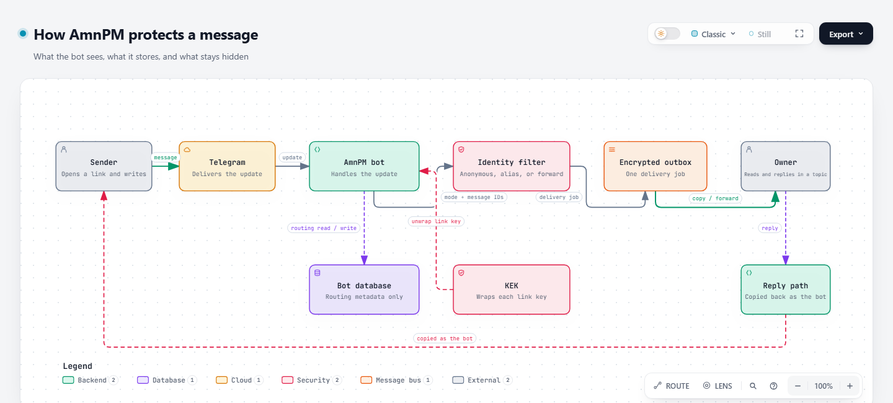
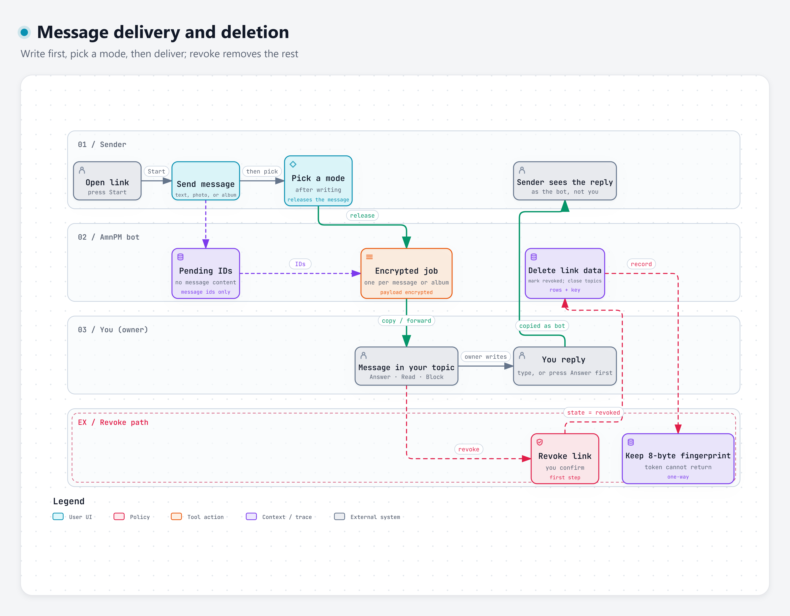

<div align="center">

# 🕊️ AmnPM

**A private, anonymous inbox behind one link.**

[](https://t.me/AmnPMBot)

[](https://github.com/411A/AmnPM/actions/workflows/test.yml)
[](https://nodejs.org)
[](https://core.telegram.org/bots/serverless)
[](#for-operators)
[](LICENSE)

[Quick start](#quick-start) • [Send modes](#send-modes) • [Commands](#commands) • [Privacy](#privacy) • [Visual guide](#visual-guide) • [Good to know](#good-to-know) • [For operators](#for-operators)

</div>

> **The name**
>
> *<b>Amn</b> (<span dir="rtl">امن</span>) is a Persian/Arabic word meaning safe, secure, protected, or free from danger. <b>PM</b> stands for Private Message.*

AmnPM turns one link into a private inbox. Share the link and anyone can message you without seeing your Telegram identity. Senders choose how much you see about them: nothing, a stable alias, or their Telegram profile.

AmnPM uses Telegram Topics to keep conversations separate: one anonymous thread per link, and one thread per sender in history or forward mode. You can reply, mark a message read, block a sender, or revoke the link at any time.

No ads. No analytics. No message archive.

AmnPM is open source under [AGPL-3.0](LICENSE). The bot runs on Telegram Serverless with no runtime dependencies; `/about` shows the release and links to the public source.

## Quick start

1. Open [@AmnPMBot](https://t.me/AmnPMBot) and press **Start**.
2. Send `/newlink main` to create your first link, or `/newlink` for an automatic name.
3. Share the link the bot gives you.
4. The sender opens it, writes a message, then picks a mode to send it.
5. You receive the message in a topic. Reply, mark it read, or block the sender from the buttons below it.
6. Use `/settings` to manage your links and receive modes.

> [!TIP]
> The link looks like `https://t.me/AmnPMBot?start=...`. Opening it starts the sender flow; nobody needs to type a token.

## Send modes

| Mode | What the owner sees | How the owner replies |
| --- | --- | --- |
| Anonymous | The message with no name or history. | Press **Answer** below the message, then write. |
| With history | A stable alias for that sender on that link, so the conversation stays connected. | Write in the sender's topic. |
| Forward | The sender's Telegram profile with the message. | Write in the sender's topic. |

Senders write first, then pick one of the modes you allow. The mode is the release step; it only changes what you see about them, and every mode delivers the message.

## Commands

| Command | Who | What it does |
| --- | --- | --- |
| `/start` | Everyone | Welcome. Owners with an active link get a button to their oldest link. |
| `/newlink [note]` | Owner | Creates a link. The optional note labels the link and its topics. |
| `/settings` | Owner | Manage links, receive modes, language, help, and about. |
| `/rename <name>` | Owner or sender | Renames the current topic. The direction and mode markers stay at the front. |
| `/help` | Everyone | Command reference and short guides. |
| `/privacy` | Everyone | Explains what is stored and what is not. |
| `/security` | Everyone | The short, plain-language security page. |
| `/about` | Everyone | Release, source, and open-source link. |

Shared links open automatically. You never need to type the token.

## Privacy

- **No message archive.** The bot does not store message text, photos, videos, or files.
- **Encrypted routing data.** Link tokens, memos, chat ids, and reply targets are encrypted at rest.
- **Revocation deletes data.** Revoking a link deletes the bot's link-scoped rows and the key that could decrypt them. Telegram keeps its own copy of the chat.
- **No ads, analytics, or application logs.**
- **Not end-to-end encrypted.** The bot operator can access messages while delivering them. The owner's identity is never shown to senders; anonymous mode also hides the sender's identity from the owner. No mode hides messages from the operator.

Report security issues privately via [SECURITY.md](SECURITY.md). Repository security setup (CodeQL, Dependabot, secret scanning, reporting) is in [docs/github-security.md](docs/github-security.md).

## Visual guide

Two code-backed maps show what happens to a message.

### How a message is protected

[](docs/diagrams/security.html)

The map follows the update from Telegram through the bot and identity filter, into the encrypted outbox, then to the owner topic. It also shows the database, the KEK, and the reply path back to the sender.

### Delivery and deletion

[](docs/diagrams/delivery.html)

The map follows pending message IDs and the encrypted delivery job to the owner topic. The lower lane shows what revoke deletes, what survives, and which one-way fingerprint remains.

The interactive versions include the source references behind every box: [security map](docs/diagrams/security.html) · [delivery map](docs/diagrams/delivery.html).

## Good to know

### For link owners

- You can have up to **10 active links**. Revoke one in `/settings` to free a slot.
- In **anonymous** mode, press **Answer** before typing a reply. In **history** and **forward** topics, just type.
- **Read** adds a 👀 reaction to the sender's message and removes the button.
- **Revoke** is in `/settings` → **My links** → the link → **Revoke**. It stops the link immediately and deletes the bot's stored data. Telegram history remains.
- Rename a topic with `/rename name` inside it. The direction and mode marker stays at the front.
- Language is in `/settings` → **Language**, below **Receive modes**: `🇬🇧 English` or `فارسی 🇮🇷`.

### For senders

- Open the link, write a message, then pick a mode.
- Write in the topic the bot gives you, not in the **All** / general tab. Messages in All are not delivered.
- Albums ask for one mode tap even after you have chosen a mode; that tap confirms the whole album arrived.
- **Forward** shows your Telegram profile. **Anonymous** does not.
- If your topic is missing, open the link again to create or restore it.

## For operators

AmnPM is open source under AGPL-3.0 and runs on Telegram Serverless with zero runtime dependencies. These sections cover running, deploying, or auditing your own instance; each is collapsed by default. You do not need them to use [@AmnPMBot](https://t.me/AmnPMBot).

<details>
<summary><b>Architecture and project layout</b></summary>

AmnPM is a single Telegram Serverless project with no runtime dependencies. Two handlers receive updates:

- `tgcloud/handlers/message.js` — commands, link opening, sender intake, owner replies.
- `tgcloud/handlers/callback_query.js` — menus, mode choice, answer/read/block/revoke actions.

A sender message is recorded as pending message IDs. The mode tap turns that group into one encrypted delivery job. The outbox drains on the next update because the platform has no timers: at most three jobs or 3.5 seconds per update. A mode tap drains exactly the one job it queued.

A sender's link topic is the only routing authority. Messages in All are never delivered; they get a pointer to the link topic, or a fresh link button if the topic is missing. Topic creation reserves the unique `(link, kind, conversation)` slot before calling Telegram, so concurrent deliveries reuse the row or retry after the creator finishes.

```text
tgcloud/
  schema.js            tables + indexes (sdk/db DSL)
  handlers/
    message.js         commands, link sessions, owner replies
    callback_query.js  mode, answer, read, block, revoke, memo
  lib/
    config.js          limits and deployment values
    constants.js       user-facing emojis and callback tokens
    bot-config.js      one-time bot metadata
    secret.js          KEK ring (deploy-only, never committed)
    build.js           generated at deploy
    crypto.js          AES-256-GCM, HMAC, split records
    ids.js             tokens, memos, indicators
    store.js           every SQL statement
    links.js           salt, user/session/sender keys, deep links
    keys.js            link keys, sealed actions, sealed jobs
    queue.js           durable outbox drain
    delivery.js        topics and jobs for messages and albums
    topics.js          create, reuse, rename, close
    menu.js            settings and link menus
    modes.js           receive-mode parsing
    render.js          message and keyboard builders
    i18n.js            English and Persian
tests/                 node:test suite with an SDK stub
tools/                 secret template, build stamp, checks, benchmarks
```

</details>

<details>
<summary><b>Deploy your own instance</b></summary>

**Prerequisites**

- Node.js 24 for the local tooling.
- A Telegram bot from @BotFather with **Topics** enabled.
- The `tgcloud` CLI, authenticated with `TGCLOUD_TOKEN` or `.tgcloud/credentials`.

**One-time secret**

```bash
cp tools/secret.example.js tgcloud/lib/secret.js
node -e "console.log(require('node:crypto').randomBytes(32).toString('hex'))"
# paste the result into secret.js as KEYS[2]
```

`tgcloud/lib/secret.js` is gitignored and deployed as code. Losing it makes every stored link undecryptable. Rotating a key means adding a new version to the ring and changing `CURRENT_KEK_VERSION`; old versions must stay while old links exist.

**Release and verification**

The release files are generated together, so `build.js`, `release/manifest.json`, and `release/notes.md` cannot drift. `--commit` defaults to `HEAD`.

```bash
RELEASE=v1.1.1
node tools/gen-build.mjs --release "$RELEASE" --verified true

git add tgcloud/lib/build.js release/manifest.json release/notes.md
git commit -m "release: $RELEASE"
git push

tgcloud push
tgcloud fetch
tgcloud migrate --yes

# Publish the same manifest as the GitHub release asset.
gh release create "$RELEASE" release/manifest.json \
  --title "$RELEASE" --notes-file release/notes.md

node tools/verify-deployed.mjs --github
tgcloud status
```

If the release tag already exists, use `gh release upload "$RELEASE" release/manifest.json --clobber` instead of `gh release create`. `gen-build` refuses `--verified true` on a dirty tree, a missing `--release`, a commit that is not an ancestor of `HEAD`, or any `tgcloud` source change after that commit; the generated `build.js` stamp is exempt. It writes all three release files in one run; do not edit them manually. The final run prints `MATCH` only when the deployed snapshot, local manifest, and GitHub asset all agree and are marked verified.

**Upgrade warning.** This revision uses a new session/sender key derivation and token format. Databases written by older revisions are not migrated in place. Start from a fresh database and create new links; old links will not resolve.

`tgcloud push` deploys code; `tgcloud migrate` applies the schema. A crash after `push` still deploys — run `tgcloud fetch` before the next push.

</details>

<details>
<summary><b>Configuration</b></summary>

All tunables live in `tgcloud/lib/config.js`. The serverless runtime has no environment variables.

| Setting | Default | Effect |
| --- | ---: | --- |
| `maxLinksPerOwner` | `10` | Active links per owner. |
| `throttlePerMinute` | `30` | Sender messages per link per minute at intake. |
| `deliverPerMinute` | `30` | Messages a sender can release per link per minute, albums included. |
| `ownerPerMinute` | `120` | Deliveries per owner per minute across all links. |
| `maxAttempts` | `5` | Delivery attempts before a job is failed. |
| `maxMemoLength` | `32` | Maximum link memo length. |
| `actionTtlSeconds` | `2,592,000` | Lifetime of owner action buttons (30 days). |
| `modeTtlSeconds` | `86,400` | Lifetime of the mode buttons after a message arrives (24 hours). |
| `tokenLength` | `10` | Characters in a link token. |
| `tokenAlphabet` | `23456789abcdefghjkmnopqrstuvwxyz` | 32 URL-safe symbols, no `0`, `1`, `i`, or `l`. |
| `kdfIterations` | `0` | `0` uses fast HMAC lookups; a positive value switches to PBKDF2. |
| `defaultMemo` | `main` | Base memo used for new links. |

Changing `kdfIterations` invalidates stored sessions and sender keys. Keep it at `0` unless you deliberately want a slower brute-force barrier.

</details>

<details>
<summary><b>Security model</b></summary>

| Data | At rest |
| --- | --- |
| Message text, media, albums | Never stored by the bot. |
| Link token | HMAC-SHA256 lookup plus AES-256-GCM ciphertext. |
| Memos, sender labels, chat ids, reply targets | AES-256-GCM under a per-link data key. |
| Wrapped data keys | Key-encryption key ring in `tgcloud/lib/secret.js`. |
| Application logs | None. |

- **Per-link envelope encryption.** Every link has its own AES-256-GCM data key; the deployment KEK wraps it. Revoking a link deletes the wrapped key, so the live database can no longer decrypt anything for that link.
- **Fast lookups by default.** Session and sender lookups use HMAC-SHA256 over a deployment salt. Setting `kdfIterations` above zero switches to PBKDF2, which raises the cost of bulk enumeration but does not make it impossible.
- **Split action records.** Values needed to answer a button are stored partly in the database and partly in `callback_data`; the database alone cannot reconstruct them. Owner actions are accepted only from the link owner, and mode actions only from the original sender. Forwarding a button does not grant access.
- **Crypto-shredding is for live data.** A backup that still contains the wrapped key can be decrypted with the deployment KEK. Shredding is not protection against the operator or against older backups.
- **No logging.** The handlers never throw, writes are single statements, and CI rejects `console`, `process`, dynamic imports, `eval`, and direct network calls in `tgcloud/`.

**Trust model.** This is a centralized bot. The operator can read updates, the deployment, the key-encryption keys, and the database, and can change and redeploy code. No application code can prevent that. The narrower guarantees are: message content is never stored; link tokens, chat ids, memos, sender labels, and reply targets are ciphertext or one-way derivations; and a database-only leak does not reveal message content, link tokens, chat ids, or reply targets without the KEK, though it still exposes counts, timing, and routing relationships. A tracked code change that adds console output, process access, dynamic imports, eval, or direct network calls is a visible diff that fails CI.

"Not even the operator" requires the key to live outside the operator's control: an external KMS/HSM with audited access, threshold keys, or client-side end-to-end encryption. Those add latency or change the Telegram flow and are not implemented.

</details>

<details>
<summary><b>Reliability and scale</b></summary>

- **At-least-once delivery.** A crash between a successful Telegram send and the job acknowledgement can duplicate one message; a lost message is never preferred.
- **429 is backpressure, not failure.** A rate-limited job returns to `pending` with a delay and keeps its retry budget. Non-429 failures retry with exponential backoff up to `maxAttempts`.
- **Abuse caps are policy ceilings.** A sender can send 30 messages/min per link and release 30/min. An owner receives at most 120/min across all links.
- **One bot has a hard ceiling.** Telegram allows roughly 30 outgoing messages per second per bot. A completed mode delivery uses up to four Bot API calls, so one bot tops out around 6–8 completed deliveries/sec bot-wide, and roughly 1–2/sec per owner because of the private-chat limit and the 120/min cap. At 100 updates/sec the queue will grow; scale-out means multiple bots or shards, which this repository does not implement.
- **No timers.** The outbox drains only when an update arrives. An idle backlog waits for the next update.

</details>

<details>
<summary><b>Testing</b></summary>

[](https://github.com/411A/AmnPM/actions/workflows/test.yml)

```bash
npm test                 # unit + integration suite
npm run check            # syntax check for every JS file and JSON manifest
npm run lint             # oxlint, zero warnings
npm run bench -- --n 200 # local handler load with in-memory SQLite
npm run bench:cloud -- --scenario start --n 20 --concurrency 5
```

`npm test` maps `sdk` and `sdk/db` onto the stubs in `tests/`, so the suite runs offline. `bench:cloud` runs the real handlers on the platform through the management API and reports server-side time; it needs `.tgcloud/credentials`. CI runs syntax, lint, no tracked secrets, unit and integration tests, policy checks, and hot-path query budgets. The plan checks run locally when `specs/` is present.

The hot-path budgets are deliberately small: open-link ≤ 12 SQL statements, sender message ≤ 15, and mode delivery ≤ 34 with at most four Bot API calls.

</details>

<details>
<summary><b>Operations</b></summary>

**Retention.** `retired_tokens` is the only table that grows without bound: an 8-byte fingerprint per revoked link, kept so a token can never be issued twice. At 10,000 new links per day that is tens of megabytes per year before index overhead. It holds no owner, sender, or message reference.

Revocation deletes every link-scoped row — jobs, actions, rates, blocks, topics, sender topics, conversations, pending messages, sessions, reply windows, and the link itself. Global **Block all** rows are owner-level and survive revocation; link-scope blocks are deleted with the link. A global block stores an HMAC of the sender so it works across links; a link-scope block uses the per-link sender key. Telegram history is retained by design.

**Topic names.** Rename a topic with `/rename <name>` inside it. The bot always prepends the mandatory direction/mode marker: `⬇️ 👽` (anonymous), `⬇️ 😶‍🌫️` (history), `⬇️ 😎` (forward), or `⬆️` (sender topic). Owner topic names keep the memo at the end (`marker + custom · memo`), so a rename never drops it and a later memo change updates every owner topic, including renamed ones. A leading U+200E left-to-right mark keeps the marker on the left when the custom name is RTL.

Owner-chosen names are stored encrypted under the link key; sender-chosen names stay only in Telegram. The Bot API has no read-topic-name method, so a rename made in the Telegram UI cannot be observed or repaired; only `/rename` is enforced.

**Bot metadata.** On the first owner `/start`, `tgcloud/lib/bot-config.js` sets the bot name, commands in English and Persian, description, short description, and menu button. It is fire-and-forget: `/start` does not wait for it. `bot_config_version` makes it one-time; bump `CONFIG_VERSION` in that file to reapply. The bot never changes the profile photo; set it manually in @BotFather.

**Concurrency invariants.** A pending mode group is claimed by exactly one callback. Owner reply windows are single, atomic, one-shot, and matched to the topic where Answer was pressed; a new Answer replaces the target. Memo prompts and reply windows exclude each other. Delivery jobs record the copied message ids, so a failed control send retries the controls without copying the message again. Revocation marks the link `revoked` before deleting, and queued jobs check the state and drop. Block buttons carry their target state, are consumed once, and are replaced with fresh tokens, so a double tap cannot flip the block back.

</details>

<details>
<summary><b>Technical limits</b></summary>

- Albums always ask for a mode tap once, even after a mode is set, because the tap is the only barrier that proves the whole album arrived (the platform has no timers).
- A failed owner-topic creation is cached as unavailable until the link is revoked; enabling Topics in @BotFather after the first failure needs a new link. Sender topics are retried on `/start`.
- Per-sender topics created before the direct-reply migration have no encrypted sender chat id yet. One Answer press or one new sender message stores it; then typing works directly. New topics are immediate.
- `closeForumTopic` is documented for supergroups only; in a bot chat the notice is posted and the topic may remain open.
- One bot cannot complete 100 deliveries/sec. The queue absorbs bursts and 429s defer instead of dropping, but sustained traffic above the Bot API ceiling produces backlog, not instant delivery.
- The platform has no transactions. A crash between a Telegram API call and its database acknowledgement can duplicate a message or leave an orphan topic; it cannot change the routing identifiers, which are always link-, chat-, and thread-scoped and bound by encryption AAD.

</details>

<sub>Licensed under the [GNU AGPL v3.0](LICENSE).</sub>
